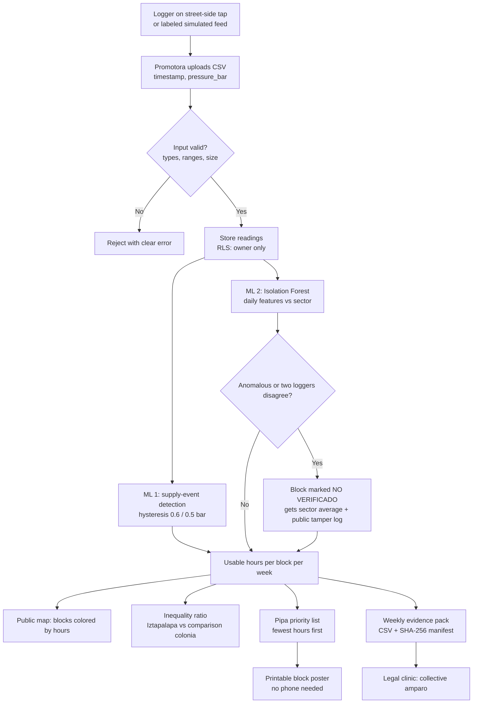
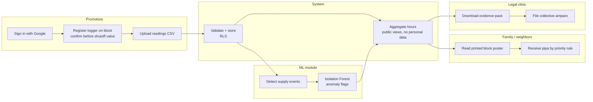
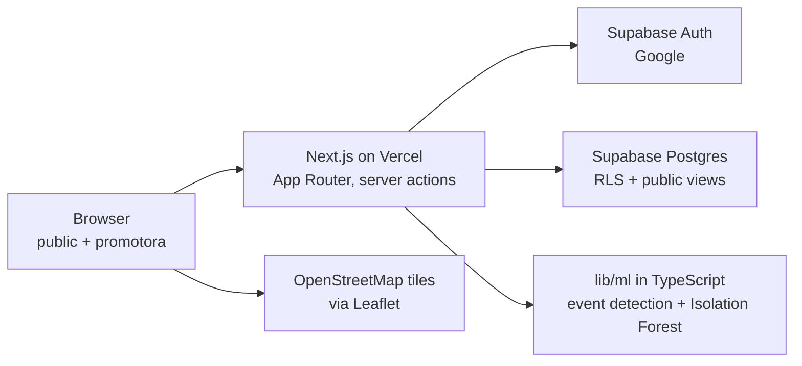

# PACKET — Mapa de Tandeo (Week 11 · Business Bending)

**Josep Ferré Gil · Role: Technologist · Team 7 · Vacuum: Household water tools (Iztapalapa)**
Blueprint primary vacuum: neighbor-owned, block-level tandeo map + published pipa-allocation rule + collective-amparo pathway.

---

## 1. Problem (in my words)

In Iztapalapa ~400,000 people get water by tandeo or pipa, but nobody independent records **when water actually arrives at each block, for how long, and with enough pressure to fill a tinaco**. Because that number doesn't exist, free pipas are handed out by request and discretion, the inequality with wealthier colonias can't be proven, and an amparo has to rely on sworn statements alone. Visibility creates no water — but without an independent block-level number, nobody can decide *fairly* who absorbs the scarcity, or force the authority to fix it.

## 2. Exact user

- **Primary operator — "Lupita", paid community promotora** (Iztapalapa, 30s, Android phone, comfortable with WhatsApp, not with dashboards). She installs a pressure logger on a street-side tap of each block, uploads the readings, and checks that devices work.
- **Beneficiary — the woman managing water at home** (often with no storage of her own and a shared phone). She never needs an account or a phone: she sees her block's result on a **printed block poster** and benefits from the **pipa priority rule**.
- **Downstream reader — legal clinic / neighbors' assembly** that downloads the evidence pack for a collective amparo.

## 3. Success definition

**Before the module closes:** a live URL where (1) a promotora signs in with Google, registers a block logger and uploads pressure readings (CSV from my real street-tap gauge test, or a labeled simulated feed); (2) the ML module turns readings into **usable-pressure hours per block per week** (> 0.6 bar) and flags suspicious devices as "no verificado"; (3) the public map shows Iztapalapa blocks vs. a comparison colonia with the **inequality ratio**; (4) the app outputs a **ranked pipa-priority list** and a **printable block poster**; (5) a weekly **evidence pack** (CSV + SHA-256 manifest) can be downloaded. All simulated data is labeled on screen.

## 4. Mockup (image-generated)

Image file: `docs/mockup.png` (generated with a free LLM image generator). Prompt used:

> Mobile web app screen, Spanish UI, title "Mapa de Tandeo · Iztapalapa". Top: a red badge "DATOS SIMULADOS". A street map of a dense Mexico City neighborhood divided into small blocks colored from red (few hours of water) to green (many hours). Below the map a card: "Horas con presión útil por semana — Iztapalapa: 9 h · Colonia de comparación: 61 h · Desigualdad: 6.8×". Then a list titled "Prioridad de pipas gratuitas" with 3 rows: "Sector 4 · 3 h/sem", "Sector 7 · 5 h/sem", "Sector 2 · 6 h/sem". A button "Imprimir cartel de la cuadra". Clean, high contrast, large readable text, flat design, white background, blue accents.

## 5. Flow

### 5.1 Flowchart — how the feature works

### 5.2 Swimlane — who does what

## 6. Benchmark

- **The best existing solution on Earth for this is** Safecast (Japan): open hardware and open, independent data that the government first dismissed and later used for its own maps.
- **Mine differs/localizes by** measuring tandeo *pressure hours per block* instead of radiation, and wiring the output directly to an action (a published pipa-priority rule) and a legal lever (amparo-grade evidence under the SCJN Ecatepec precedent), with no human reporter in the loop (the NextDrop lesson).

## 7. Long view (3 years)

If this slice works, Mapa de Tandeo becomes the independent, neighbor-owned record of water delivery for every tandeo colonia in CDMX, with ~1–2 loggers per block maintained by paid promotoras. Its weekly hours-per-block index is written into the reglas de operación of the free-pipa program and cited in collective amparos, so allocation stops depending on who asks or who knows someone. Calibrated with tinaco level sensors, it converts hours into liters per person per day — the exact number the Supreme Court now requires the authority to prove.

## 8. Scope cut (NOT building this week)

- Real LoRaWAN / NB-IoT hardware ingestion (CSV upload + labeled simulator instead).
- Real-time "water is coming" alerts (NextDrop lesson + 2–4 week lag condition).
- Hours → liters calibration (needs 30–45 tinaco sensors; documented, not built).
- Automatic mirroring to Zenodo/university (manifest + hashes built; mirroring is manual).
- Computer-vision gauge reading from photos (my physical test is transcribed to CSV).
- Any household-level data, names, phones or addresses. Any tips or awareness content (forbidden zone).

## 9. Architecture + stack (free tier only)

| Layer | Choice | Why |
|---|---|---|
| Frontend + API | Next.js (App Router, TypeScript), Tailwind | One repo, deploys free on Vercel |
| Hosting | Vercel (Hobby) | Env vars for secrets, preview + prod deploys |
| Auth | Supabase Auth — Sign in with Google | Security floor |
| Database | Supabase Postgres + Row Level Security | Promotora sees only her devices/readings; public sees only block aggregates |
| IoT / sensing | CSV ingest from real street-tap gauge test + labeled simulated logger feed | Stack floor: phone-as-sensor / simulated feeds allowed, labeled |
| ML | Supply-event detection (hysteresis + min duration) and Isolation Forest anomaly detection, pure TypeScript | Stack floor: ML; no paid APIs, testable |
| Geodata | Leaflet + OpenStreetMap, block polygons/points in GeoJSON | Stack floor: "one more" |
| Validation | zod on every form and API route | Security floor |
| Tests | Vitest (unit), manual mechanical pass logged | Test-fix-redeploy |

**Data model**
- `blocks` — id, colonia, sector, label, lat, lng, group (`study` / `comparison`), is_simulated. Public read.
- `devices` — id, block_id, owner (auth uid), label, before_shutoff_valve (bool), created_at. RLS: owner only.
- `readings` — id, device_id, ts, pressure_bar, source (`simulated` / `real_test`), owner. RLS: owner insert/select.
- `flags` — id, block_id, week, reason, score. Public read (tamper log).
- Public views: `block_week_stats` (hours > 0.6 bar per block per week — aggregate, published immediately) and `readings_public` (raw minute data only older than 14 days).

## 10. Blueprint conditions → design

| Condition | How the slice honors it |
|---|---|
| 1 · No single intermediary, benefit to the individual | Sensors, not valvemen; two-logger rule; no person approves data; allocation is a published formula |
| 2 · Shadow clause | Public pages need no login and no phone; printable poster per block; pipa rule benefits families with no storage |
| 3 · Signal → action | Every hours number feeds the pipa-priority list and the evidence pack |
| 4 · No capture | Open code, weekly SHA-256 manifest for external mirroring, no government money, devices registered to neighbors' promotoras |
| 5 · Legal hook | Evidence pack formatted for a collective amparo (hours per block, comparison colonia, hashes) |
| 6 · Block is the unit | No household data; raw data 14-day lag; aggregates sooner |

## 11. Test plan

**Mechanical (automated + manual)**
1. Unit: event detection finds the right number and duration of events in synthetic series (incl. air-pocket spikes and a booster-pump distortion).
2. Unit: Isolation Forest flags the injected tampered device and not normal ones.
3. Unit: inequality ratio and pipa ranking on a known fixture.
4. Security: anon user cannot read `readings` or `devices` directly; user A cannot read user B's devices (RLS check script).
5. Validation: CSV with bad dates, negative pressure, > 5,000 rows or > 1 MB is rejected.
6. Manual: upload my real gauge CSV → block appears with hours; poster prints; evidence pack hash matches re-computed hash.
7. Find ≥1 bug, fix, redeploy; log in `docs/TEST_LOG.md`.

**Persona test (fresh chat)**
Persona: *"Eres Doña Rosa, 52, vive en Iztapalapa, administra el agua de su casa, tiene un tinaco pequeño, comparte el celular con su hijo, lee despacio y desconfía de las apps del gobierno; si algo no se entiende, se rinde sin decir nada."* Walk her through: public map → her block → poster → pipa list. Second persona: *"Lupita, promotora, 34"* for login → register logger → upload CSV. Log every confusion in `PERSONA_JosepFerreGil.pdf`; fix the worst one.
